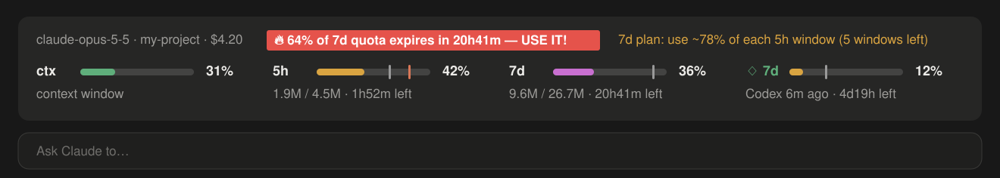
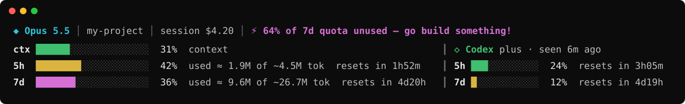
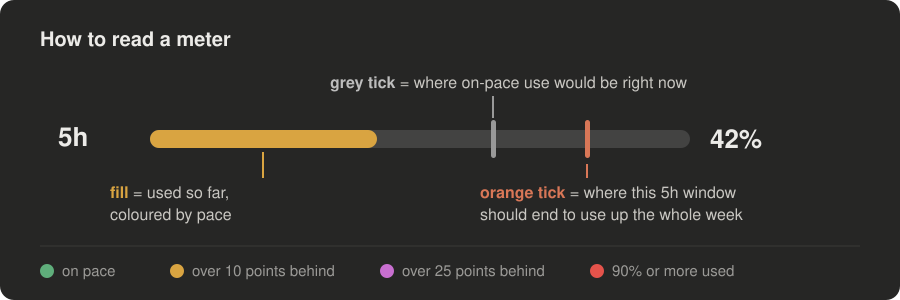
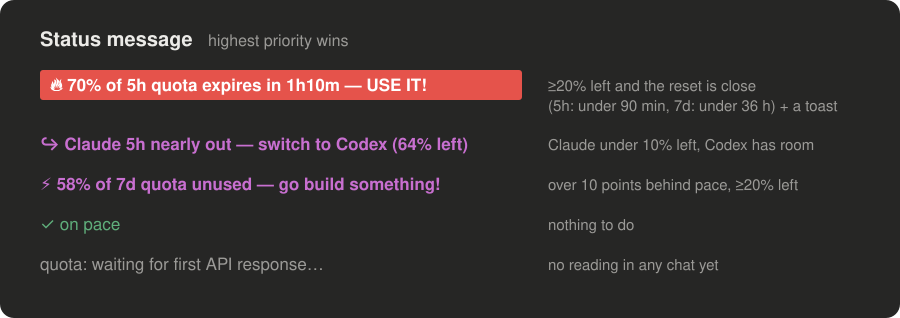

# usage-band

**Your Claude and Codex quota, always on screen in Claude Code.** A plugin that draws a live band above the
prompt showing the context window, the 5-hour and 7-day rate-limit windows, real token counts, how far
ahead or behind pace you are, and your Codex limits next to them. It also tells you when quota is about to
expire unused.



In the terminal it uses the same layout as a classic status line:



## Features

- **Live meters** for the context window, the Claude **5h** and **7d** windows, and every **Codex** window,
  each with its reset countdown.
- **Real token counts.** A background scanner totals the tokens in your local transcripts since each window
  began and estimates the window's full size: `1.9M / 4.5M` means 1.9M tokens used and about 4.5M in the
  whole window.
- **Pace colours.** Every bar is coloured by how far ahead or behind an even pace you are, with a grey tick
  marking where on-pace use would be now.
- **7-day plan.** Works out how much of each remaining 5h window you need to use for the week not to expire
  (`7d plan: use ~78% of each 5h window (5 windows left)`), and puts an orange tick on the 5h meter where
  this window should end.
- **Nudges.** The status message picks the most useful thing to say right now (see below), and a toast fires
  once when a window first turns urgent.
- **Codex aware.** Reads your latest Codex rate limits from Codex's own session logs and suggests switching
  when Claude is nearly out and Codex has room.
- **Always the freshest figure.** All chats share one quota, so every chat saves its readings and each window
  shows the newest one any chat has seen ("latest reading 2m ago"). A chat you return to is never stuck on
  the numbers from its last reply.
- **Live updates.** Refreshes every 15 s, whenever the desktop attaches to a chat, and on redraw, so
  countdowns and figures keep moving between turns.
- **Two layouts.** Drawn meters on the desktop; the classic character-bar layout in the terminal.
- **`/quota` pane** with the full view and a button to hide or show the band.
- **Quiet in scripts.** Headless runs (`claude -p`, tests, automation) skip the scanner, timers and toasts.

### How to read a meter



### Status message



## Requirements

- Claude Code **2.1.286 or newer**, with function-hook plugins (an early-access API; it may change between
  releases).
- **Node.js** on your `PATH`. The band itself needs no Node, but token totals and the Codex column come from
  `scripts/usage-scan.js`. Without Node the meters still work; the token counts and the Codex column stay
  empty and the band says why.
- A Claude subscription that reports rate limits (Pro or Max). Codex is optional.

## Install

1. Clone the repository anywhere:

   ```bash
   git clone https://github.com/visavv/claude-usage-band.git ~/.claude/mods/usage-band
   ```

2. Tell Claude Code to load it in every session by adding this to `~/.claude/settings.json`:

   ```json
   {
     "env": {
       "CLAUDE_CODE_PLUGIN_DIRS": "~/.claude/mods/usage-band"
     }
   }
   ```

   On Windows use the full path, e.g. `"C:\\Users\\you\\.claude\\mods\\usage-band"`. Separate several plugin
   folders with `;` on Windows and `:` elsewhere.

3. Start a new session, or relaunch the desktop app. The band appears above the prompt and fills in after the
   first reply in any chat.

To try it in one session only: `claude --plugin-dir ~/.claude/mods/usage-band`.

## Commands and options

| | |
|---|---|
| `/quota` | Open the usage pane (full view, Hide/Show band button, hotkey `h`) |
| `/quota hide`, `/quota show` | Hide or show the band |
| `CLAUDE_CONFIG_DIR` | Where Claude Code keeps its data (default `~/.claude`); the transcripts are read from here and the two state files are written here |
| `CODEX_HOME` | Where Codex keeps its data (default `~/.codex`) |

### Optional: the same view as a CLI status line

`extras/statusline.js` draws the terminal layout as a Claude Code status line and shares the scanner and its
cache with the band. Add to `~/.claude/settings.json`:

```json
{
  "statusLine": {
    "type": "command",
    "command": "node ~/.claude/mods/usage-band/extras/statusline.js",
    "padding": 0,
    "refreshInterval": 30
  }
}
```

## Privacy and what it touches

Everything stays on your machine. The plugin makes **no network requests**.

| | |
|---|---|
| Reads | `~/.claude/projects/**/*.jsonl` (token counts only, by `usage-scan.js`), the last 512 KB of your 8 newest Codex session logs (rate limits only) |
| Writes | `~/.claude/statusline-usage.json`: token totals per window and the latest Codex limits. `~/.claude/usage-band-models.json`: each model family's last quota percentages and reset times |
| Runs | `node scripts/usage-scan.js` with the window start times as arguments; no shell |

No transcript text, prompt or file content is copied anywhere.

## How the numbers are worked out

- **Window capacity** is an estimate: tokens counted ÷ percent used. It is noisy early in a window and
  ignores cache reads, which are cheap and would swamp the total.
- **Pace**: behind = elapsed % of the window − used %. Red at 90% used or more, magenta over 25 points
  behind, yellow over 10, otherwise green. A window whose reset time has passed counts as 0% used.
- **Urgent**: at least 20% left and the reset is close (5h: under 90 minutes, 7d: under 36 hours).
- **7d plan**: the 7d quota left ÷ what the remaining 5h windows can hold, each worth (5h capacity ÷ 7d
  capacity) of the week. It assumes you start each new window promptly, and is hidden until both windows are
  at least 1% used.

## Development

```bash
claude plugin validate .   # manifest, hooks and state contract
claude plugin test .       # tests/*.test.ts against the real engine
```

For type-checking, run `/plugin-types` in a Claude Code session to write the engine's declarations into
`.claude/types`, then `npx -p typescript tsc -p .`.

| | |
|---|---|
| `hooks/register.tsx` | Hooks: data refresh, timers, toasts, the band and the pane |
| `hooks/logic.ts` | Pure logic: pace, colours, nudges, the 7d plan, merging readings |
| `scripts/usage-scan.js` | Token and Codex scanner (Node) |
| `extras/statusline.js` | Optional CLI status line |
| `types/index.d.ts` | The plugin's state contract |

## Known limits

- Claude Code reports quota per account, not per model; all models share the same windows.
- The desktop draws each meter as a static image. Animated meters would need a sandboxed frame, which the
  desktop paints with a white background.
- A chat that is already open keeps the plugin version it started with; relaunch the app after updating.

## License

MIT
